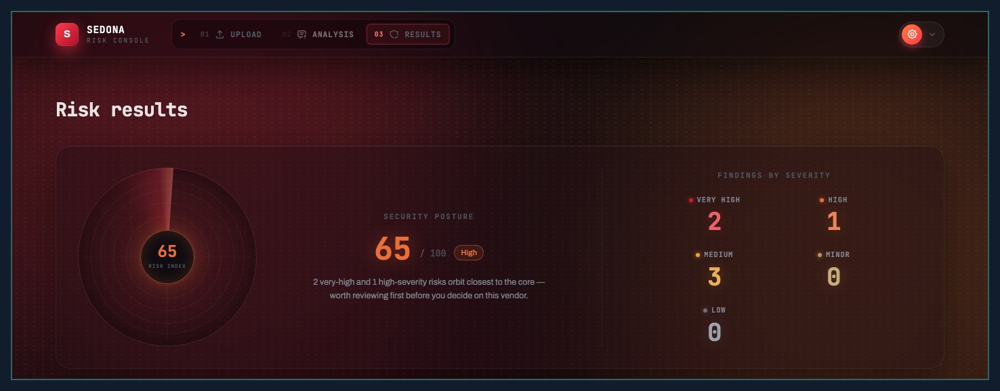

# Aditya Jain

I’m an IT and AI graduate based in Dubai. I like building tools that make complex information easier to work with.

[LinkedIn](https://www.linkedin.com/in/itzadx-sudo/)

## Featured projects

### [Sedona](https://github.com/itzadx-sudo/Sedona)

Sedona is our capstone project for Murdoch University IT. It checks vendors’ answers to security questionnaires against university policies, highlights gaps for reviewers, and generates reports they can share with their team.

### [Hearth AI](https://github.com/itzadx-sudo/Hearth-AI)

Hearth AI is a home-care monitoring demo that uses simulated patient data. The dashboard charts vital signs such as heart rate and blood pressure in real time, shows patient risk scores, and raises alerts when a patient needs attention.

