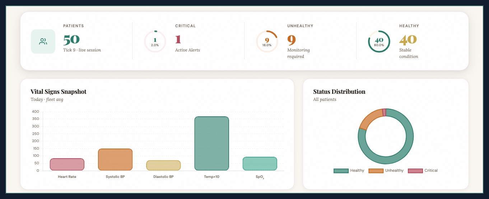

# Aditya Jain

**Product × AI × Design**

I'm an AI graduate from Murdoch University, based in Dubai. I build tools that make complex information easier to work with, and I care as much about how a product feels to use as whether it works.

[LinkedIn](https://www.linkedin.com/in/itzadx-sudo/) · [Email](mailto:adityajain009@icloud.com)

## What I do

- **Product:** discovery, user flows and prioritisation, then turning rough ideas into working prototypes.
- **AI:** applied machine learning and LLM workflows, from local models to risk-scoring pipelines.
- **Design:** interface design and prototyping, with attention to layout, spacing and clarity.

## Featured projects

### [Sedona](https://github.com/itzadx-sudo/Sedona)

Sedona is our capstone project for Murdoch University IT. It checks vendors' answers to security questionnaires against university policies, highlights gaps for reviewers, and generates reports they can share with their team.

**My role:** Product Lead for a team of six. I led product direction, client communication, the frontend redesign, testing and documentation.

**Built with:** local LLM workflows, HECVAT-based assessment, risk scoring.

### [Hearth AI](https://github.com/itzadx-sudo/Hearth-AI)

Hearth AI is a home-care monitoring demo that uses simulated patient data. The dashboard charts vital signs such as heart rate and blood pressure in real time, shows patient risk scores, and raises alerts when a patient needs attention.

**My role:** Team Lead for a team of three, built as a Murdoch University project.

**Built with:** Python, PyTorch, TabNet, SQLite. Tested on 500 simulated patients.

## More work

- **[PlanetExplorer](https://github.com/itzadx-sudo/PlanetExplorer):** a NASA Space Apps Challenge 2025 hackathon project that classifies Kepler signals as Confirmed, Candidate or False Positive. I led a team of six, preprocessed the data, and designed and built the Lumina web interface.
- **[Formula 1 Tweet Analysis](https://github.com/itzadx-sudo/Formula1---Tweet-Analysis):** topic modelling with BERTweet and BERTopic on a 45,000-tweet sample, grouping 19,248 cleaned tweets into 248 topics.
- **[Mental Health Sentiment Dashboard](https://github.com/itzadx-sudo/Mental-Health-Sentiment-Analysis):** a six-page Dash dashboard exploring sentiment and text patterns across 51,192 public statements in seven categories. I led the dashboard design in a team of five.

## Tools

**Tools:** Python, SQL, PyTorch, scikit-learn, LLM workflows and RAG (llama.cpp, Ollama, ChromaDB), Dash and Plotly, Git and GitHub, AWS and Azure, Figma, Claude Code, Google Antigravity.

**Certification:** GitHub Foundations (GH-900), Nov 2026.
